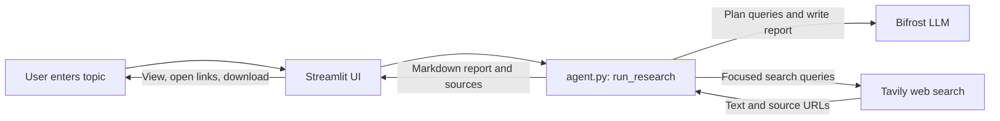

# Pitch deck draft

## Slide 1 — AI Research Assistant

**From a question to a cited research report.**

Team: _Add team member names_

## Slide 2 — Problem

- Researching a topic means searching many pages and tabs.
- Useful findings are scattered across sources and difficult to compare.
- Writing a concise report with traceable citations takes time.

## Slide 3 — Solution

Enter a topic in the Streamlit app. The backend creates focused search
questions, gathers web sources with Tavily, and uses an LLM through Bifrost to
write a structured Markdown report with citations. The UI displays clickable
sources and lets the user download the report.

## Slide 4 — System architecture

## Slide 5 — Key features

- Focused, multi-query web research with Tavily.
- Structured Markdown reports with numbered citations.
- Clickable source cards and a downloadable report.
- Live progress, example prompts, and a one-click reset.
- Bifrost model retry: Groq primary, Gemini backup.

## Slide 6 — Tech stack and future scope

**Tech stack:** Streamlit, Python, Tavily, Bifrost, Groq, and Gemini.

**Future scope:** configurable report depth, export formats, team-level usage
limits, and additional providers or research sources.
